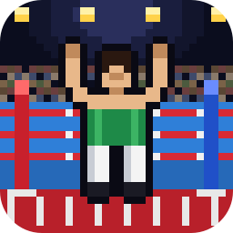
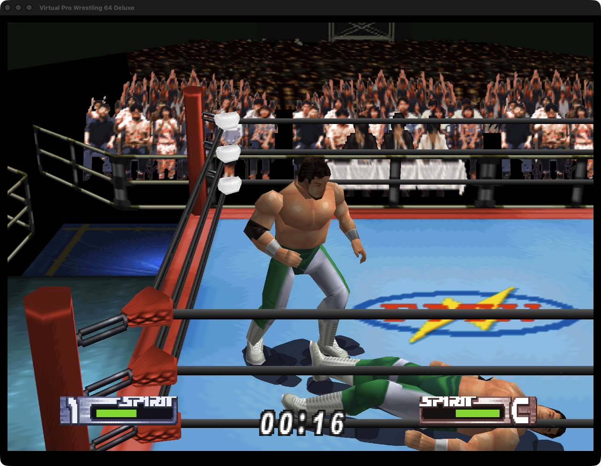
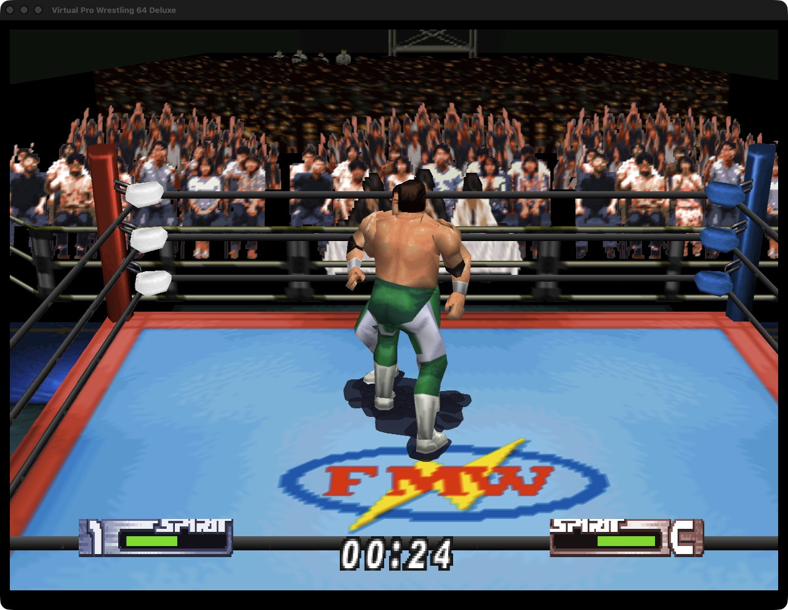
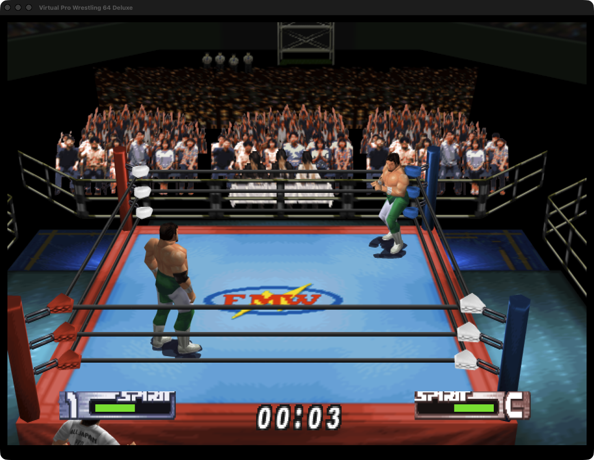
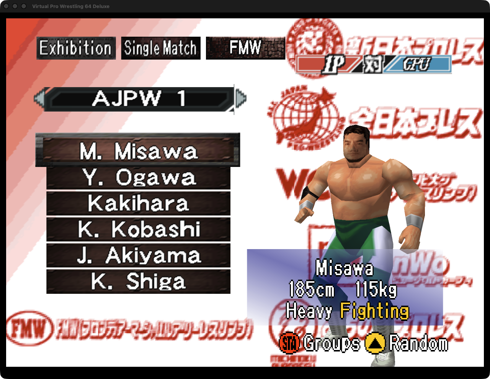
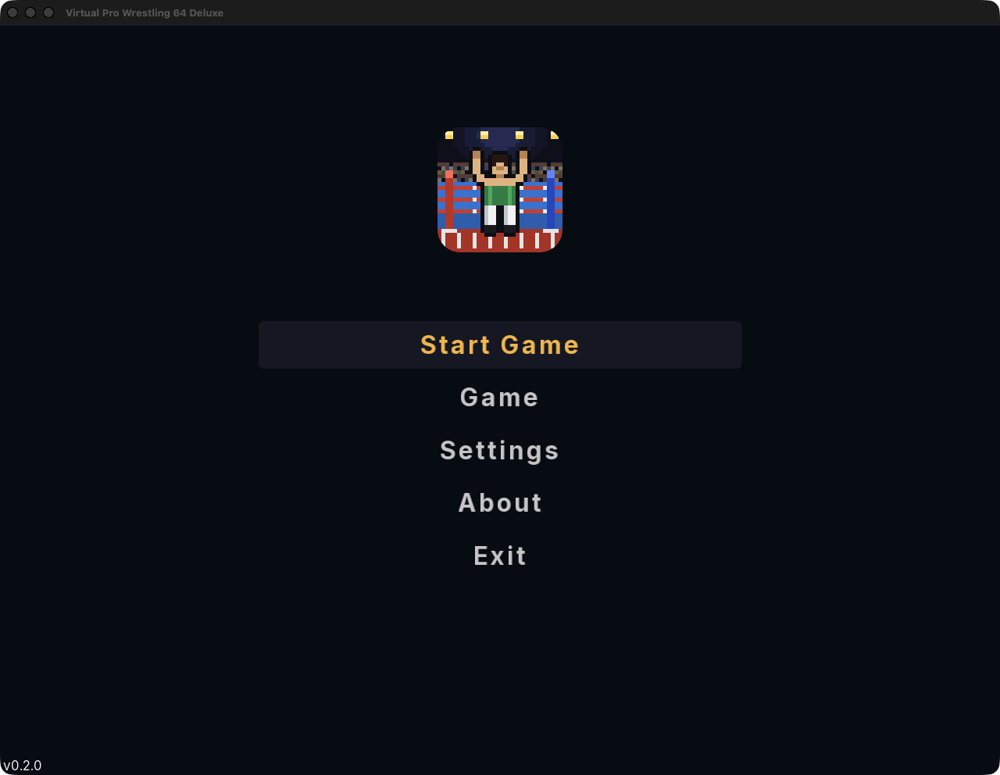
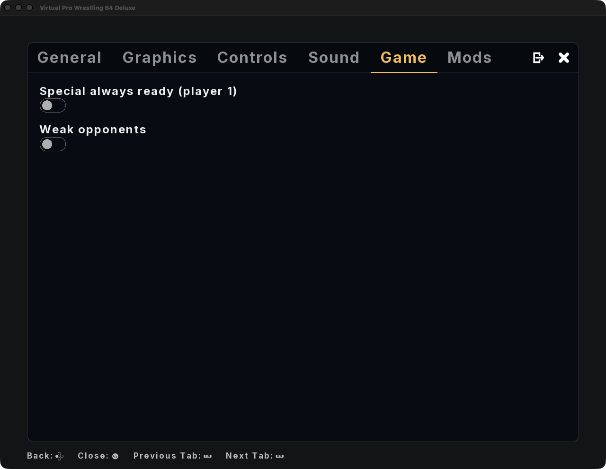

<p align="center">
  
</p>

<h1 align="center">Virtual Pro Wrestling 64 Deluxe, native for Mac and Linux</h1>

<p align="center">
  The Nintendo 64 wrestling game (the 2026 Deluxe fan edition of Virtual Pro Wrestling 2), rebuilt as a real program for your computer.<br>
  Sharp graphics at any size, a proper launcher, controller support, and cheats.<br>
  <b>Free. Bring your own copy of the game.</b>
</p>

**Website:** [vpw64deluxe.tanookistudios.com](https://vpw64deluxe.tanookistudios.com)

## Download

| Your computer | Download | |
|---|---|---|
| **Mac** (Apple chip or Intel, macOS 13+) | [**VPW64Deluxe-Mac.zip**](https://github.com/TanookiStudios/VPW64DeluxeRecomp/releases/latest/download/VPW64Deluxe-Mac.zip) | Signed and notarized by Apple |
| **Linux** (64-bit, desktops from 2022 on) | [**VPW64Deluxe-Linux.tar.gz**](https://github.com/TanookiStudios/VPW64DeluxeRecomp/releases/latest/download/VPW64Deluxe-Linux.tar.gz) | |

Every version and its notes are on the [Releases page](https://github.com/TanookiStudios/VPW64DeluxeRecomp/releases).
A Windows version is coming in a later release (it has to be built on a Windows PC: this engine's Windows side needs Microsoft's own compiler and shader tools).

## How to play

1. Download the version for your computer and unzip it.
   - **Mac:** drag **VPW64 Deluxe** into Applications (or anywhere) and double-click it.
   - **Linux:** open the folder and double-click **VPW64Deluxe** (or run `./VPW64Deluxe`).
2. The launcher asks for your game. Pick your own **Virtual Pro Wrestling 64 Deluxe** ROM
   (a `.z64` file). The launcher checks it and remembers it.
3. Set any options you like (the **Game** button has the cheats), then press **Start Game**.

No game files come with this download. The ROM that works is:

| | |
|---|---|
| Game | Virtual Pro Wrestling 64 Deluxe (fan edition of Virtual Pro Wrestling 2, Japan) |
| Size | 63.7 MB (66,846,720 bytes), big-endian `.z64` |
| SHA-1 | `2ad9eb023a93f74c4f77e313a8bd583cec0c53d9` |

### Controls

| Nintendo 64 | Keyboard | Controller |
|---|---|---|
| Control stick / D-pad | Arrow keys | Left stick / D-pad |
| A | Z | A (bottom button) |
| B | X | B (right button) |
| C buttons | I J K L | Right stick |
| L / R | Q / E | Triggers |
| Z | Left Shift | Left stick click |
| Start | Enter | Start |
| **This port's menu** | **Esc** | **Home / Guide button** |

**Controllers:** plug one in and play, no setup. Xbox, PlayStation, Switch Pro and most other pads are
recognized by name, and everything can be remapped in **Settings → Controls**.

## What's in it

- **Native code.** The game's own program was translated into native code, so it runs as a real Mac or Linux app.
- **Sharp at any size.** Render the 3D at your screen's resolution (or higher) in Settings → Graphics.
- **Launcher.** Set everything before you play: display, sound, controls, cheats.
- **In-game menu (Esc).** Change settings or quit without losing your place.
- **Saves.** The game's own saves work, kept in your settings folder with automatic backups.
- **Cheats (Game tab).** Special always ready for player 1 (the SPIRIT bar stays maxed and lit), and weak opponents (everyone else has no spirit: soft hits, no specials, easy pins). Want an opponent who never fights back? Pick **1P vs 2P** before the wrestler select and leave player 2 alone.

Settings and saves live in `~/Library/Application Support/VPW64Deluxe` on a Mac and `~/.config/VPW64Deluxe` on Linux.

## The game this runs

| | |
|---|---|
| Mod | **Virtual Pro Wrestling 64 Deluxe** (the title screen says "Virtual 64 Pro Wrestling Deluxe") |
| Mod author | Lowwater, 2026 |
| Based on | **Virtual Pro Wrestling 2: Ōdō Keishō** (AKI Corporation / Asmik Ace Entertainment, Nintendo 64, Japan, 2000) |
| What the mod changes | a bigger roster across several promotions, new arenas, English menus, and many engine tweaks; the original game's code is kept and extended |

This port runs the mod's ROM only. The retail Virtual Pro Wrestling 2 cartridge and the FreeM edition are different images and will not be accepted.

## Screenshots

<p align="center">
  
  <br>
  
  <br>
  
  
</p>

## Building it yourself

You need the ROM (see above), a Mac with Xcode's command-line tools, CMake and Ninja (`brew install cmake ninja`),
and Python 3 with `capstone` for the mapping tools (`python3 -m venv work/venv && work/venv/bin/pip install capstone`).

```bash
./setup.sh                    # fetches the engines into vendor/ and applies patches/
cp /path/to/your.z64 rom/vpw64deluxe.z64
tools/regen.sh                # translates the ROM into C (RecompiledFuncs/, never committed)
cmake -S . -B build -G Ninja -DCMAKE_BUILD_TYPE=Release && cmake --build build --target VPW64Deluxe
tools/capture.sh work/proof 40 "" 30       # unattended boot test: a screenshot of the title at 30 s
```

Release builds: `tools/make_app.sh --notarize` (Mac) and `tools/make_linux.sh` (Linux, needs Colima).
`notes/hack-map.md` explains how the fan edition's code was mapped; `docs/GATE2-REPORT.md` is the bring-up report.

## About Maddie

Hi, I'm Maddie. I make apps and games on my own at Tanooki Studios. This port is free and will stay free.
You bring your own copy of the game; nothing from the cartridge ships with it. It isn't made by or affiliated
with AKI, Asmik Ace, the Deluxe edition's authors or Nintendo.

Making apps (including some decomps) is how I pay my bills. If this brought you some nostalgia, you can
[leave a tip](https://tanookistudios.com/SupportMe). It really helps!

## Credits and legal

Built on [N64Recomp](https://github.com/N64Recomp/N64Recomp), jessetbh's forks of
[N64ModernRuntime](https://github.com/jessetbh/N64ModernRuntime), [RecompFrontend](https://github.com/jessetbh/RecompFrontend)
and [RT64](https://github.com/jessetbh/rt64), and the VPW2 function map and tools from
[jessetbh/VPW2Recomp](https://github.com/jessetbh/VPW2Recomp). Licensed under the GPL-3.0 (see `LICENSE` and
`THIRD_PARTY_NOTICES.md`). The icon is our own pixel art. Virtual Pro Wrestling is a trademark of its owners;
this is a fan project.
